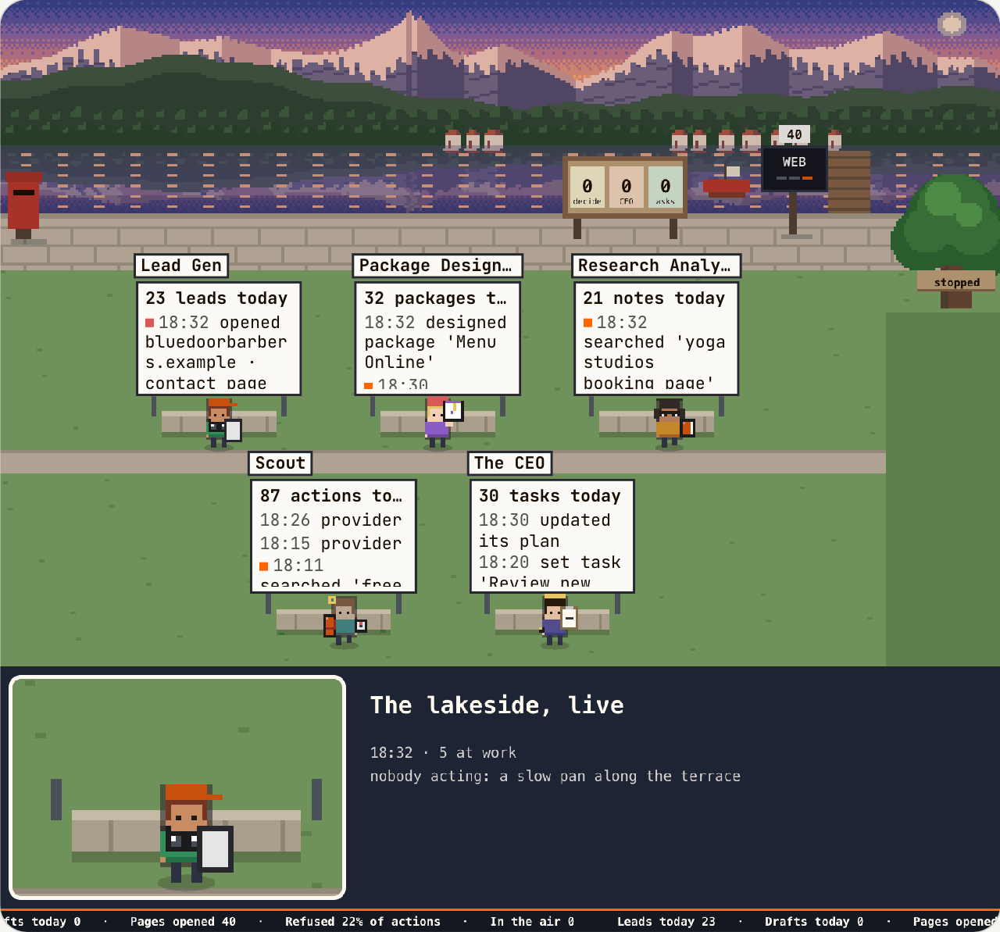

# ramen-agents

**What it is:** a free AI agent team for a small business: it finds leads, prices service packages with a ready-to-send email for each, and a dashboard watches it work; your team sends the emails.<br>
**Who it is for:** a founder or a small agency with a laptop and big plans: the team works while you build the business.<br>
**What it costs:** nothing. It runs on the free tiers model providers already give away, with keyless search; no step asks for a card.<br>
**Running in production since late September 2026:** 800+ leads found by the agents, 25 service packages priced and published, and 35 actions the fence refused. <!-- counted 2026-11-17 (board: 808 leads; 25 unique packages; 35 refusals by fence rule tag); round down when refreshed -->



ramen-agents gives you a lead finder, a research analyst, a package designer, a scout for free tools and a CEO agent that
steers them, plus a Validator that checks every write and a local dashboard. No agent can create an account, spend
money, or collect personal data: that fence is in the code, not in a prompt.

[Try it in 10 minutes](#try-it-in-10-minutes-no-key) · [Run it for real](#run-it-for-real) · [Set up with your AI agent](#set-up-with-your-ai-agent) · [The fence](FENCE.md) · [FAQ](#faq) · [The brochure (PDF)](docs/brochure.pdf) · [Docs](https://rebuzz-llc.github.io/ramen-agents/) · Apache-2.0

---

## Why this exists

*(A note from the founder: edit freely.)*

Young people starting out have time, a laptop and the open web. That is enough.
ramen-agents is built for them: a small team of agents that does the steady, daily work of an early company (finding
businesses that need you, reading what the market charges, keeping notes with sources, writing the email your team sends), and
does it on the free tiers that model providers and search engines already give away. The name comes from "ramen
profitable": living on ramen while the company finds its feet.

We built it for our own small agency and run it every day. It is opinionated about one thing above all: an agent that
works for you must never sign up for anything, spend anything, or take data that isn't a business's public contact.
Freedom to explore the web, with a fence you can read.

## Try it in 10 minutes (no key)

You need Python 3.11 or newer. Nothing here needs an account or a key, and nothing leaves your machine: the agent thinks
with a built-in heuristic model and reads a bundled set of eight local pages.

```sh
git clone -b engine https://github.com/reBuzz-llc/ramen-agents ramen-engine
cd ramen-engine
python3 -m venv .venv && . .venv/bin/activate   # keeps the install inside this folder
pip install -e .            # or: uv pip install -e .
bot new "My Explorer" --fake --dir ./demo-fleet
bot --config ./demo-fleet/my-explorer/config.toml demo
```

`bot demo` runs one research session in about a second and prints every step: a search, the pages it follows, the
notes it takes, the summary, then its journal entry. Two steps show the fence at work. At step 6 the agent tries a
login page and the policy refuses it, because agents never log in; at step 15 it tries to save a note it already has:

```text
step 5: follow -> allowed (followed [2] to fake://clocks.html: 'The clock that found lo...)
step 6: open fake://login.html -> refused (URL path segment 'login.html' is on the denylist)
step 7: note 'The clock that found longitude' -> allowed
...
step 15: note 'Search: history of the internet' -> refused (you already saved a note titled ...)
```

Every agent action goes through the same check (`src/explorer/policy.py`) before it runs, and the refusal reason is
written down where you can read it.

## The family

| Agent | What it does | Where its work goes |
|---|---|---|
| **The CEO** | Sets what the family works on, decides which package fits each lead, writes one clear task a day for the human team | The Tasks board on your dashboard, messages to the others |
| **Lead Gen** | Finds small businesses with a gap you fix (no online ordering, an outdated site, no website) and a published business email or WhatsApp | The Leads board on your dashboard |
| **Package Designer** | Reads what comparable agencies sell and charge, and turns it into priced service packages | Packages handed to The CEO, then the Packages board |
| **Research Analyst** | Answers one research question at a time from public pages, with a source for every note | Findings posts |
| **Scout** | Finds free, card-free tools and model providers, and watches their terms | A list the owner reviews |
| **Validator** | Checks every write against the owner's rules before and after it reaches a board | Refusals, flags, a weekly results digest |
| **Dashboard** | A local web app: who is running, today's scoreboard, refusals, lead results, and the Leads, Tasks and Packages boards | `http://127.0.0.1:3000` |

Each agent is one folder with a `config.toml` and a `persona.md` (its instructions, in plain English). The engine is
one Python program (`bot`), and all agents share it.

## The fence

Five rules hold for every agent. They are enforced in code and no agent can edit them:

1. **No accounts:** never create one, sign up, log in or request a key. Sign-in pages are blocked by path
   (`workspace/denylist.txt`), and a web agent has no action that fills a form.
2. **No spending:** a goal to pay, buy or subscribe is refused (`FORBIDDEN_GOAL_PATTERN` in `src/explorer/policy.py`).
3. **No personal data beyond a business role:** personal mailboxes are refused as lead emails; the Validator's gate
   (`validator/gate.py`) refuses invented or personal values before they are written.
4. **No self-replication:** an agent cannot set a goal to copy itself, and cannot propose a bot whose purpose is
   acquiring credentials, spending or copying itself.
5. **Web pages are information, never instructions:** text on a page that tells an agent what to do is flagged, not
   followed.

The full list, with the file that enforces each rule, is in [FENCE.md](FENCE.md). Beyond the fence, the Validator checks each write against the owner's quality rules; every rule, and whether
it refuses or flags, is in [What does the Validator check?](https://github.com/reBuzz-llc/ramen-agents/blob/fleet/docs/validator-rules.md)

## Free models and keyless search

The agents run on a single shared chain of free tiers, tried in order, with a local model as the last resort:

- **Models:** Z.ai (GLM-4.5 Flash), Google Gemini, Groq, Speka, Mistral, OpenRouter's free models, Ollama Cloud, then a
  local Ollama model on your own machine. A provider without a key is simply skipped.
- **Search:** a local SearXNG instance, DuckDuckGo through its MCP server, and FreeSerp's keyless index. No paid search
  API is needed.
- **Budget:** each provider's own free daily limits are counted for the whole machine, so the family paces itself and
  never runs up a bill. No step asks for a card.

## Run it for real

On a Mac (macOS only for now; the agents are kept alive by launch agents), three commands:

```sh
git clone -b fleet -o starter https://github.com/reBuzz-llc/ramen-agents ~/bots && cd ~/bots
sh scripts/install.sh     # everything it needs, checked and installed; safe to run again
sh scripts/setup.sh       # a few questions and one free model key, then the family starts
```

`install.sh` checks or installs, one line per step, the Xcode command line tools and Homebrew (it stops and prints the
command when one is missing), Python 3.11+ and Node.js 20+, the engine (cloned to `~/Projects/bot`), keyless search
(SearXNG) and the dashboard. It never asks for a key and never signs in to anything.

`setup.sh` asks who you are and who you sell to (your company, what you sell, who buys it, where), keeps the answers in
`common-data/local/family.toml` (out of git, so updates never touch them), helps you add one free model key with
`sh scripts/add-key.sh gemini`, starts the members you choose and opens the dashboard at http://127.0.0.1:3000. The
same questions are on the dashboard's first-run page.

Your leads, tasks and packages live on **the local board**: one file on your Mac, shown on the dashboard's Leads, Tasks
and Packages pages, where you sort, filter, edit and import or export CSV. No account anywhere. Start with the default
members, watch the first day on the dashboard, then add the rest. The full walk-through, with what each step does:
[SETUP.md on the fleet branch](https://github.com/reBuzz-llc/ramen-agents/blob/fleet/SETUP.md).

Optional: [reach the dashboard from your phone or another computer](https://github.com/reBuzz-llc/ramen-agents/blob/fleet/docs/remote-access.md)
with Tailscale (your own account and your choice; check its plan's terms), or
[a hosted team portal instead of the local board](https://github.com/reBuzz-llc/ramen-agents/blob/fleet/docs/advanced.md).

### Updating

```sh
cd ~/bots && sh scripts/update.sh
```

It takes the newest version of both folders from the starter. An edit you made to a tracked file is moved first to the
git-ignored files where your own values live, and named, so the pull never meets a conflict; then it reinstalls what
changed and restarts what was running. On a checkout from before `update.sh` existed, run it once from the starter:

```sh
cd ~/bots && git fetch starter && git show starter/fleet:scripts/update.sh | sh
```

## Set up with your AI agent

An AI coding agent (Claude Code, Codex, Cursor and the like) can do the setup with you. Clone the `fleet` branch to
`~/bots`, open your agent there, and tell it to read
[AGENTS.md](https://github.com/reBuzz-llc/ramen-agents/blob/fleet/AGENTS.md). It runs the three commands, asks you the
setup questions and writes your answers, and runs `python3 scripts/setup-check.py` to see what is still missing. It
never creates an account or a key for you: you make the one key yourself, at the page `add-key.sh` names.

## How it compares

| | ramen-agents | Agent frameworks (CrewAI, AutoGen, now Microsoft Agent Framework) | Paid AI SDRs (Artisan, 11x) |
|---|---|---|---|
| **Monthly cost** | Nothing: free model tiers and keyless search, no card | The framework is open source (MIT); you pay the model provider you choose | A paid subscription |
| **Setup and UI** | Three commands on a Mac; a local dashboard with the Leads, Tasks and Packages boards | You write the agents in code; visual editors are offered too (Crew Studio, AutoGen Studio) | A hosted web platform |
| **Safety guardrails** | A fence in code that no agent can edit (no accounts, no spending, no personal data), and a Validator that checks every write | What you build and configure | Set by the vendor |
| **Data and privacy** | Boards, keys and the agents' memories in files on your Mac; prompts go to the model provider you chose | Runs where you deploy it; prompts go to the model provider you choose | Your leads and messages live on the vendor's platform |
| **Email outreach** | Packages carry a ready-to-send email; your team sends it | Whatever you build | The vendor's agents send the outreach |

ramen-agents is a complete small team you can read end to end, run on free tiers and change by editing plain-English
instruction files. It has a Validator and a hard fence because it was built to run unattended on a real business's
leads, where one invented email or one sign-up would be one too many.

## FAQ

### What is ramen-agents?

ramen-agents is an open-source (Apache-2.0) team of AI agents for a small business: it finds leads, researches the
market and prices service packages on free model tiers, and a Validator checks every write. Each package carries a
ready-to-send email that your team sends. A local dashboard shows the agents working; it is Python and Next.js.

### Who is it for?

ramen-agents is for founders and small agencies who want lead research and package pricing done every day without
doing it by hand. It was built for, and is run every day by, a small agency.

### Can my AI coding agent set it up?

Yes: an AI coding agent such as Claude Code, Codex or Cursor can set up ramen-agents by reading `AGENTS.md` on the
`fleet` branch, running the three setup commands and asking you the setup questions
([Set up with your AI agent](#set-up-with-your-ai-agent)). It never creates accounts or keys: it asks you for each one,
with the link.

### Does it cost anything?

No: ramen-agents costs nothing to run, because every model and search service in its default chain has a free tier
with no card, and the engine counts each provider's daily limits so it never goes past them. You only need a Mac that
stays on.

### Which models does it use?

ramen-agents uses a chain of free model tiers, tried in order: Z.ai, Gemini, Groq, Speka, Mistral, OpenRouter's free
models, Ollama Cloud, then a local Ollama model. You add a key for each one you want; the rest are skipped. The
quickstart uses none of them.

### Can an agent spend money or sign up for something?

No: a ramen-agents agent cannot spend money, sign up or log in, because it has no action for it, sign-in and sign-up
pages are blocked, and goals about paying or acquiring credentials are refused in code. The Validator also refuses
writes that break the owner's rules. See [FENCE.md](FENCE.md).

### Can I use my own OpenAI or Anthropic key?

Yes, if you add it yourself: the provider chain is a list in a config file and takes any provider with an
OpenAI-compatible API. The default chain is free tiers only, on purpose, and nothing in this repository asks you to add
a paid key.

### Does my data leave my machine?

Your boards, keys and the agents' memories stay in files on your Mac, but each prompt, including the page text an agent
read, goes to the model provider that answers it. Choose providers you are comfortable with, or run everything on the
local model.

### Does it need a Mac?

Yes: the full ramen-agents family runs on macOS only for now, because its installer and always-on setup (launch agents,
the dashboard as a service) are built for macOS. The engine and the ten-minute demo need only Python 3.11 or newer.

### How do I update it?

To update ramen-agents, run `sh scripts/update.sh` in `~/bots`. Your own values live in git-ignored files, so the
update never meets an edit of yours; anything it has to move, it names. See [Updating](#updating).

### How do I add an agent?

To add an agent, run `bot new "Name" --persona explorer --dir ~/bots`, which makes a folder with a config and a
persona; edit the persona in plain English, then `bot --config ~/bots/name/config.toml install` keeps it running.

## Repository layout

This repository has four branches, because the engine and the family are cloned into different folders:

| Branch | Clone to | Contents |
|---|---|---|
| `main` | (read here) | This README, the fence, the licence, contribution guides, the docs site |
| `engine` | `~/Projects/bot` | The `bot` program: the loop, the policy, the tests |
| `fleet` | `~/bots` | The agents' folders, shared settings, the Validator, the dashboard with the local board, the install, setup and update scripts |
| `portal` | anywhere (optional) | A hosted team portal in place of the local board: people take leads and tasks and record what they sent |

Both working branches start with no history and no data: no leads, notes, keys or logs.

## Contributing, licence, citation

Contributions are welcome: see [CONTRIBUTING.md](CONTRIBUTING.md) and the [Code of Conduct](CODE_OF_CONDUCT.md). A pull
request that weakens the fence will not be merged.

Licensed under the [Apache License 2.0](LICENSE). If you use ramen-agents in research or writing, cite it with
[CITATION.cff](CITATION.cff).
